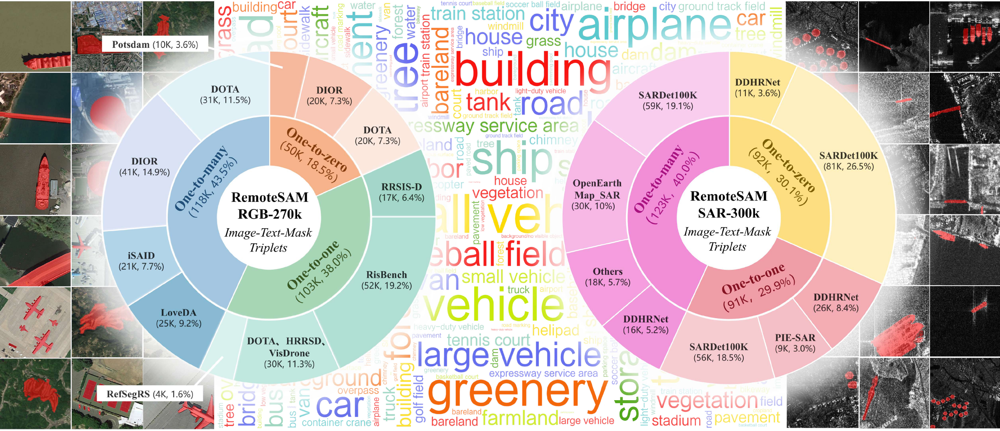
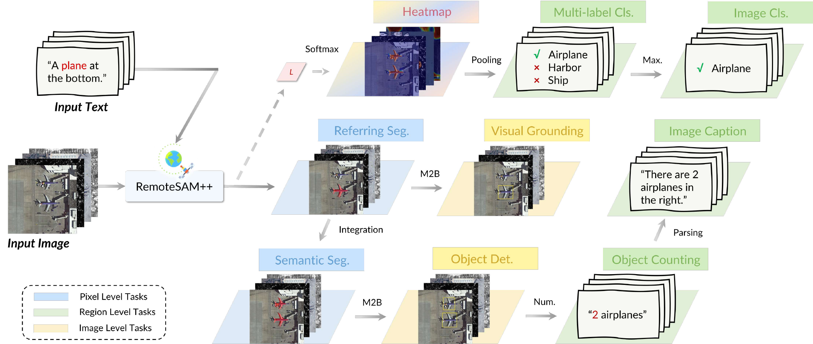

<div align="center">

# RemoteSAM++

</div>

## Introduction

Welcome to the official repository of **RemoteSAM++**!

RemoteSAM++ is a segmentation-centric foundation model for RGB and SAR Earth observation. It uses referring expression segmentation as a common interface, predicting pixel-level masks from images and natural-language queries. DINOv3 ConvNeXt-B and GTE-ModernBERT provide visual and textual representations, while lightweight modality-gated LoRA branches adapt sensing-dependent visual features within a shared backbone. Vision–language interaction and the mask predictor remain shared across modalities.

[](assets/backbone.pdf)

We also construct **RemoteSAM-520K**, a generalized referring segmentation dataset containing 520K image–text–mask triplets, 358 semantic categories, and 25 attribute types. It extends optical supervision with SAR observations and covers one-to-one, one-to-many, and one-to-zero referring settings.

[](assets/dataset2.pdf)

Through mask-centered task transitions, the same model supports eight tasks: referring expression segmentation, semantic segmentation, visual grounding, object detection, multi-label classification, image classification, image captioning, and object counting. These pixel-, region-, and image-level outputs are obtained without trainable task-specific heads.

[](assets/transition.pdf)

## Setting Up

We use Python 3.11 and PyTorch 2.7.1. First, clone the repository and enter its root directory:

```shell
git clone https://github.com/1e12Leon/RemoteSAM-PlusPlus.git
cd RemoteSAM-PlusPlus
```

### Package Dependencies

1. Create and activate a Conda environment:

```shell
conda create -n RemoteSAMPP python=3.11
conda activate RemoteSAMPP
```

2. Install PyTorch with a CUDA build suitable for your machine (CUDA 12.6 is used here):

```shell
pip install torch==2.7.1 torchvision==0.22.1 --index-url https://download.pytorch.org/whl/cu126
```

3. Install the remaining dependencies:

```shell
pip install -r requirements.txt
```

### The Initialization Weights for Training

Place the pretrained DINOv3 ConvNeXt-B and GTE-ModernBERT model directories in the repository root. For inference, place the RemoteSAM++ checkpoint in `checkpoints/`:

```text
RemoteSAM-PlusPlus/
├── dinov3-convnext-B/
├── gte-modernbert-base/
└── checkpoints/remotesam_plusplus.pth
```

To enable EPOC, additionally place DirectSAM in `chendelong/DirectSAM-EntitySeg-1024px-0501/`. CIDEr evaluation requires Java.

## Data Preparation

### Usage

Organize RemoteSAM-520K in the existing RemoteSAM reference/COCO annotation format:

```text
datasets/RemoteSAM-520K/
├── images/
├── refs(unc).p
└── instances.json
```

Each reference provides an image filename, referring expression, split, annotation ID, and modality (`rgb` or `sar`). Annotation IDs correspond to the masks in `instances.json`.

## RemoteSAM++

### Training

We use PyTorch DistributedDataParallel for training. To train on eight GPUs on a single node:

```shell
CUDA_VISIBLE_DEVICES=0,1,2,3,4,5,6,7 torchrun --nproc_per_node=8 train.py \
  --imageFolder ./datasets/RemoteSAM-520K/images \
  --ref_file_path './datasets/RemoteSAM-520K/refs(unc).p' \
  --instances_path ./datasets/RemoteSAM-520K/instances.json \
  --use_modal_lora --modal_lora_stages 0,1 \
  --modal_lora_targets pointwise_conv1,pointwise_conv2 \
  --output-dir ./checkpoints/paper
```

The default settings are 40 epochs, 896×896 inputs, and batch size 2 per GPU. More training options are available in `args.py`.

### Getting Started

Initialize RemoteSAM++ with the supplied model configuration and checkpoint:

```python
import json
from pathlib import Path

import torch
from PIL import Image
from args import get_parser
from tasks.code.model_auto import RemoteSAM
from tasks.code.runtime import load_model_and_text_encoder

args = get_parser().parse_args([])
vars(args).update(json.loads(Path("configs/paper_model.json").read_text()))
args.resume = "./checkpoints/remotesam_plusplus.pth"
args.device = "cuda:0"

network, text_encoder, device = load_model_and_text_encoder(args)
model = RemoteSAM(network, device, use_EPOC=False, args=args, text_encoder=text_encoder)
```

Then explore the eight tasks through the same interface. Input modality is inferred from image content:

```python
image = Image.open("/path/to/image.png").convert("RGB")
classnames = ["airplane", "vehicle"]

with torch.inference_mode():
    mask = model.referring_seg(image=image, sentence="the airplane on the right")
    masks = model.semantic_seg(image=image, classnames=classnames)
    box = model.visual_grounding(image=image, sentence="the airplane on the right")
    boxes = model.detection(image=image, classnames=classnames)
    labels = model.multi_label_cls(image=image, classnames=classnames)
    label = model.multi_class_cls(image=image, classnames=classnames)
    caption = model.captioning(image=image, classnames=classnames)
    counts = model.counting(image=image, classnames=classnames)
```

### Evaluation

Task-level launchers are provided under `tasks/`: `REF`, `SEG`, `VG`, `DET`, `MLC`, `MCC`, `CAP`, and `CNT`. Select the modality and dataset with command-line arguments. For example:

```shell
# RGB referring expression segmentation
bash tasks/REF.sh --modal rgb --dataset rrsisd \
  --resume ./checkpoints/remotesam_plusplus.pth \
  --images /path/to/images --refs '/path/to/refs(unc).p' \
  --instances /path/to/instances.json

# SAR semantic segmentation
bash tasks/SEG.sh --modal sar --dataset whu \
  --resume ./checkpoints/remotesam_plusplus.pth \
  --data-root /path/to/SegEarthOV2
```

Use `python tasks/run.py --list` to list supported configurations, or `bash tasks/REF.sh --help` for arguments. The corresponding Python entry points are in `tasks/code/eval/`. Add `--epoc` for DET, CNT, or CAP when required.
