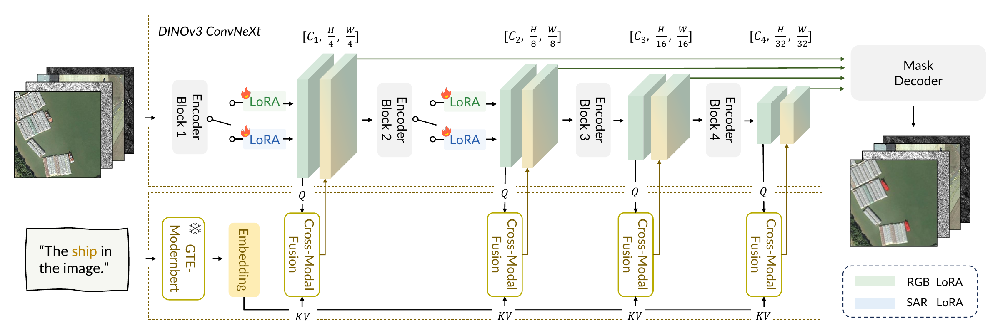

<div align="center">

# RemoteSAM++

### A Mask-Centered Foundation Model for Multi-modal Earth Observation

Liang Yao · Fan Liu · Junjie Zhou · Chuanyi Zhang · Ziyun Chen · Shimin Di

[Code](https://github.com/1e12Leon/RemoteSAM-PlusPlus) · [RemoteSAM](https://github.com/1e12Leon/RemoteSAM)

</div>

## Overview

We aim to construct a robust, flexible visual foundation model for Earth observation that unifies heterogeneous tasks while preserving fine-grained perception. Existing approaches either use task-specific heads, which fragment knowledge and require separate adaptation, or language-based unification, which is less suited to dense spatial outputs. We instead regard the pixel-level mask as a fundamental representation from which region- and image-level predictions can be derived while retaining spatial evidence. Referring expression segmentation, which predicts a mask conditioned on a natural-language query, thus provides a natural interface for visual tasks at multiple granularities. Based on this principle, we present RemoteSAM++, a segmentation-centric foundation model for general Earth observation.

To extend this formulation across sensing modalities, we construct RemoteSAM-520K, a generalized referring segmentation dataset containing 520K image–text–mask triplets, 358 semantic categories, and 25 attribute types. Beyond expanding the semantic coverage of optical imagery, it incorporates SAR observations through sensing-appropriate expressions. Because optical and SAR images may depict the same targets but exhibit markedly different imaging statistics, RemoteSAM++ upgrades its visual and textual encoders and equips the shared visual backbone with lightweight modality-gated LoRA branches. These branches adapt sensing-dependent visual features while preserving shared vision–language interaction and a common language-conditioned mask interface.

A unified mask predictor therefore operates across the enlarged data domain, and its outputs are interpreted for eight tasks spanning pixel-, region-, and image-level understanding without trainable task-specific heads. Extensive experiments on diverse Earth observation benchmarks demonstrate strong effectiveness, generality, and parameter efficiency. These results support pixel-level masks as a fundamental computational unit for unified visual intelligence in Earth observation.

### Architecture

[](assets/figures/backbone.pdf)

### RemoteSAM-520K

[](assets/figures/dataset2.pdf)

### Downstream Tasks

One mask-centered interface supports referring segmentation, semantic segmentation, visual grounding, object detection, multi-label classification, image classification, image captioning, and object counting.

[](assets/figures/transition.pdf)

## Installation

```bash
conda create -n remotesam_plusplus python=3.11
conda activate remotesam_plusplus
pip install torch==2.7.1 torchvision==0.22.1 --index-url https://download.pytorch.org/whl/cu126
pip install -r requirements-eval.txt
```

Place the pretrained encoders and RemoteSAM++ checkpoint as follows. EPOC additionally uses DirectSAM; CIDEr evaluation requires Java.

```text
RemoteSAM-PlusPlus/
├── dinov3-convnext-B/
├── gte-modernbert-base/
├── checkpoints/remotesam_plusplus.pth
└── chendelong/DirectSAM-EntitySeg-1024px-0501/  # EPOC
```

## Training

Prepare images, `refs(unc).p`, and COCO-format `instances.json`. References include expressions, split information, annotation IDs, image filenames, and `modal` (`rgb` or `sar`).

```bash
CUDA_VISIBLE_DEVICES=0,1,2,3,4,5,6,7 python tools/train_paper.py \
  --nproc-per-node 8 \
  --imageFolder ./datasets/RemoteSAM-520K/images \
  --ref_file_path './datasets/RemoteSAM-520K/refs(unc).p' \
  --instances_path ./datasets/RemoteSAM-520K/instances.json
```

Default settings: 896×896 inputs, 20 text tokens, 40 epochs, and batch size 2 per GPU. Modality-gated LoRA is applied to stages 0 and 1 with rank 4, alpha 8, and dropout 0.05. Settings are in [configs/](configs/); add `--dry-run` to inspect a command.

## Evaluation

The eight task-level entry points share the same interface for RGB and SAR:

```text
tasks/code/eval/{REF,SEG,VG,DET,MLC,MCC,CAP,CNT}.py
```

List supported evaluation configurations with `python tasks/run.py --list`, or use `--help` on a task entry point.

```bash
# RGB referring expression segmentation
CUDA_VISIBLE_DEVICES=0 python tasks/code/eval/REF.py \
  --modal rgb --dataset rrsisd --resume ./checkpoints/remotesam_plusplus.pth \
  --images /path/to/images --refs '/path/to/refs(unc).p' \
  --instances /path/to/instances.json

# SAR semantic segmentation
CUDA_VISIBLE_DEVICES=0 python tasks/code/eval/SEG.py \
  --modal sar --dataset whu --resume ./checkpoints/remotesam_plusplus.pth \
  --data-root /path/to/SegEarthOV2
```

Use `--epoc` for DET, CNT, or CAP when required. Same-named shell launchers are available under `tasks/`.

## Acknowledgements

This project builds on [RemoteSAM](https://github.com/1e12Leon/RemoteSAM), DINOv3, GTE-ModernBERT, and DirectSAM. We thank the authors for making their work available.
